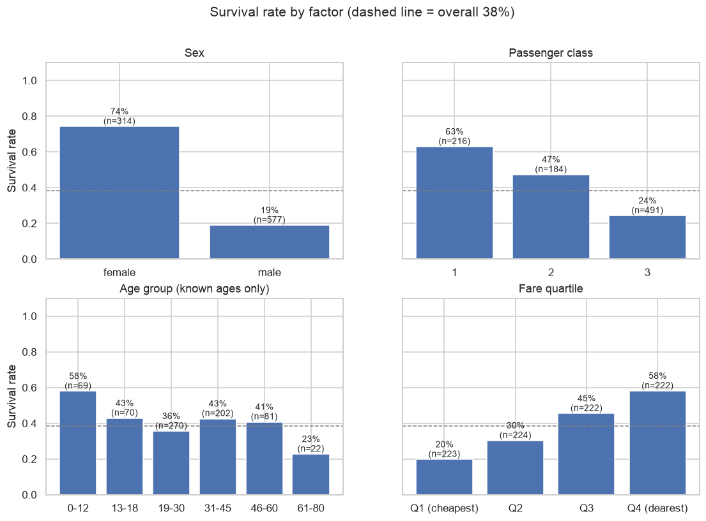
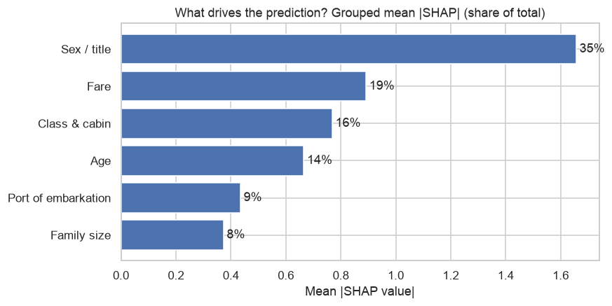
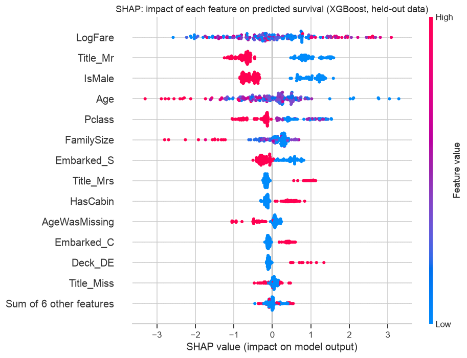

# Titanic: what decided who survived?

An analysis of the Kaggle Titanic dataset that answers two questions:

1. **Which factors influenced survival?** Exploratory analysis first, then confirmation from three independent model explanations: Logistic Regression coefficients, tree feature importances and SHAP.
2. **How well can survival be predicted?** Logistic Regression, Random Forest and XGBoost, compared against simple baselines using stratified hold-out evaluation and 25-fold repeated cross-validation.

📓 **Full analysis:** [`notebooks/titanic_analysis.ipynb`](notebooks/titanic_analysis.ipynb)

## Key findings



| Factor | Evidence | Share of the model's explanation* |
| --- | --- | --- |
| **Sex / title** | 74% of women survived vs 19% of men | **35%** |
| **Fare** | 20% → 58% from the cheapest to the dearest fare quartile | 19% |
| **Class & cabin** | 63% / 47% / 24% for 1st / 2nd / 3rd class | 16% |
| **Age** | 58% of children under 13 survived, vs 38% overall | 14% |
| **Port of embarkation** | mostly a proxy for class | 9% |
| **Family size** | 30% alone, 58% in families of 2-4, 16% in families of 5+ | 8% |

\*Grouped mean |SHAP| for XGBoost on held-out passengers. Correlated columns (e.g. `IsMale` and `Title_*`) are summed, so a factor isn't split across several features.



Class changes what sex means: women in 1st class survived at 97% but women in 3rd class only at 50%, and men in 1st class (37%) did more than twice as well as men in 3rd (14%).

## Model results

| Model | CV accuracy (5×5 folds) | Hold-out accuracy | Hold-out F1 | Hold-out ROC AUC |
| --- | --- | --- | --- | --- |
| Always "died" | 61.6% | 61.5% | 0.00 | 0.50 |
| "Women survive" rule | 78.7% ± 2.6 | 77.7% | 0.69 | 0.75 |
| **Logistic Regression** | **83.3% ± 2.2** | **83.8%** | **0.79** | **0.87** |
| Random Forest | 82.4% ± 2.0 | 82.1% | 0.75 | 0.85 |
| XGBoost | 82.9% ± 2.3 | 81.0% | 0.74 | 0.82 |

- **All three models are statistically tied,** within one standard deviation of each other. With good features the relationships are close to linear, so the interpretable Logistic Regression is the one to use.
- **They all beat the "women survive" rule** by about 4-5 accuracy points.
- **Errors concentrate in 3rd-class women (34%) and 1st-class men (33%),** the groups where the dominant patterns break down. Every other group is at 11% or less.



## Method

- **Feature engineering** lives in [`src/features.py`](src/features.py), a scikit-learn transformer:
  - a title from the name (Mr / Mrs / Miss / Master / Rare);
  - family size and a travelling-alone flag;
  - age filled with the median **for that title and class**;
  - a cabin flag and deck group;
  - log fare;
  - Embarked filled with the most common port.
- **No data leakage.** Every fill-in value is learned in `fit()` from training data only, and the transformer sits inside each model pipeline, so cross-validation re-learns it on every training fold.
- **Evaluation.** A stratified 80/20 split keeps the ~38/62 class balance, and hyperparameters are tuned with 5-fold CV on the training split only. The report covers accuracy, precision, recall, F1, ROC AUC and confusion matrices, plus repeated stratified CV (25 fits per model) to check stability.
- **Explainability:** standardised Logistic Regression coefficients, Random Forest and XGBoost importances, permutation importance on held-out data, and SHAP beeswarm, dependence and grouped plots.

## Run it

```bash
python3 -m venv .venv
.venv/bin/pip install -r requirements.txt
.venv/bin/python -m pytest                       # feature engineering tests
cd notebooks && ../.venv/bin/jupyter notebook titanic_analysis.ipynb
```

Download `train.csv` and `test.csv` from [Kaggle: Titanic - Machine Learning from Disaster](https://www.kaggle.com/competitions/titanic/data) into `data/` (they are not included in this repo). Running the notebook regenerates every chart in `reports/figures/`, `reports/metrics.json`, and `reports/submission.csv` (Kaggle predictions).

## Project structure

```
data/                       put Kaggle train.csv and test.csv here (not committed)
notebooks/                  titanic_analysis.ipynb (executed, with outputs)
src/features.py             feature engineering transformer
tests/test_features.py      unit tests (14)
reports/figures/            all charts
reports/metrics.json        every reported number
reports/submission.csv      Kaggle test-set predictions
```
